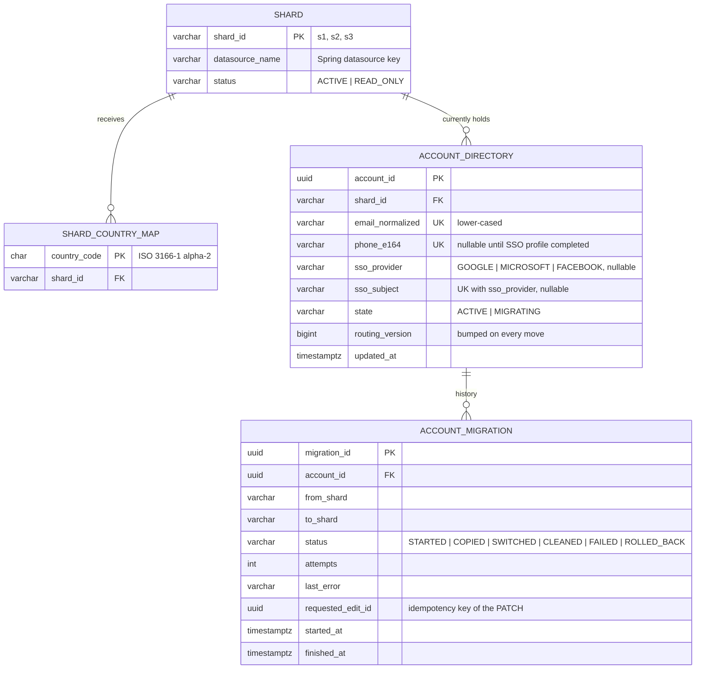
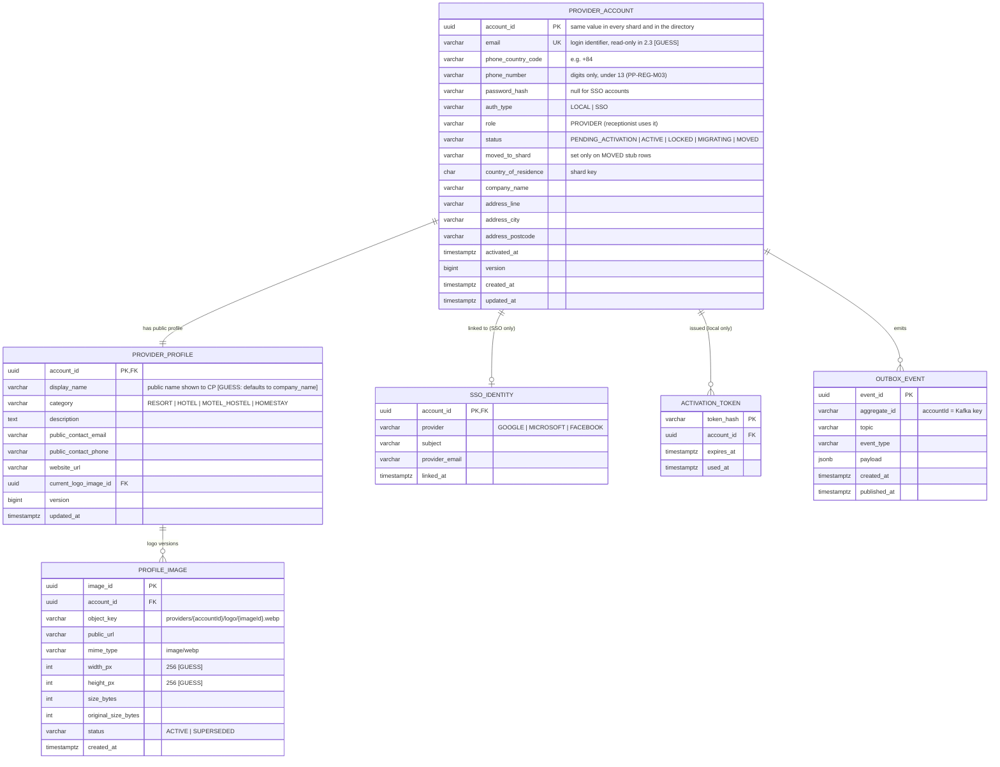
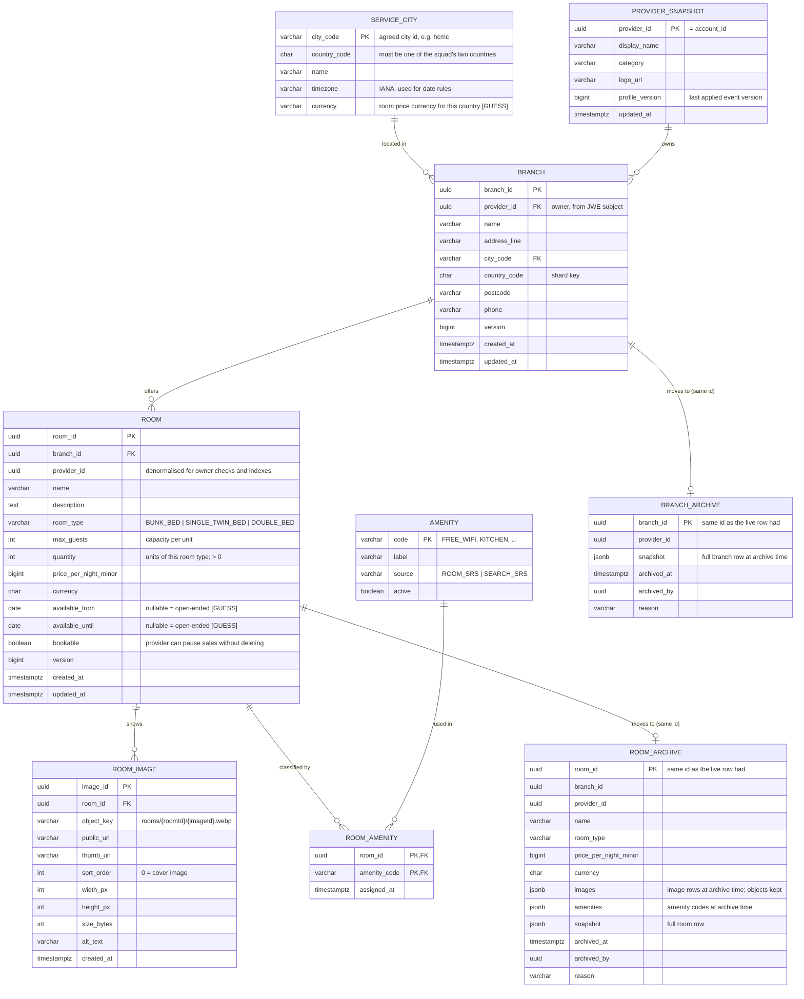
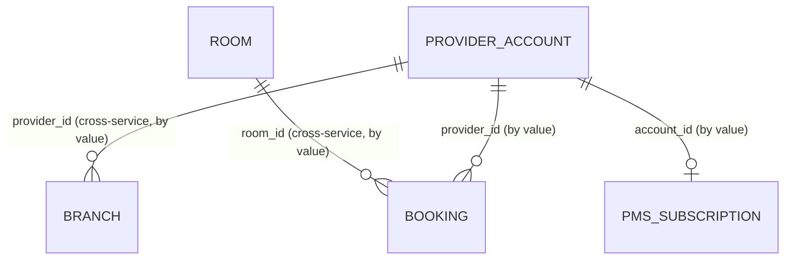
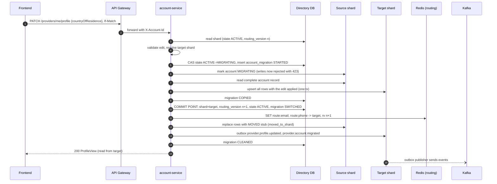
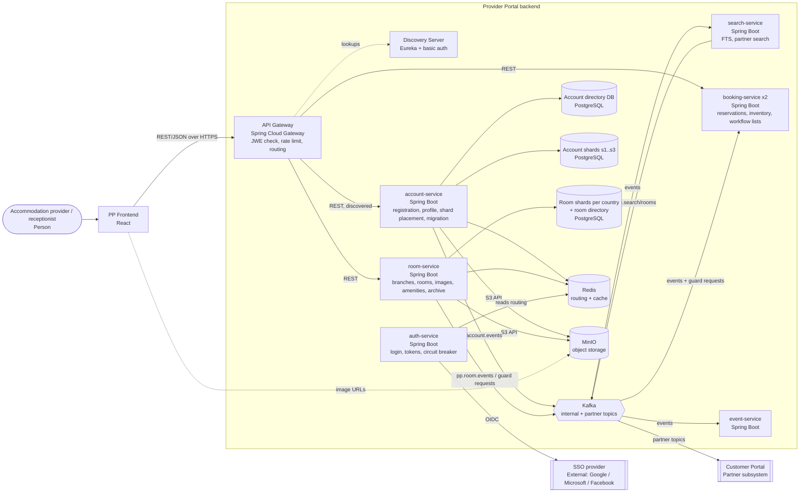
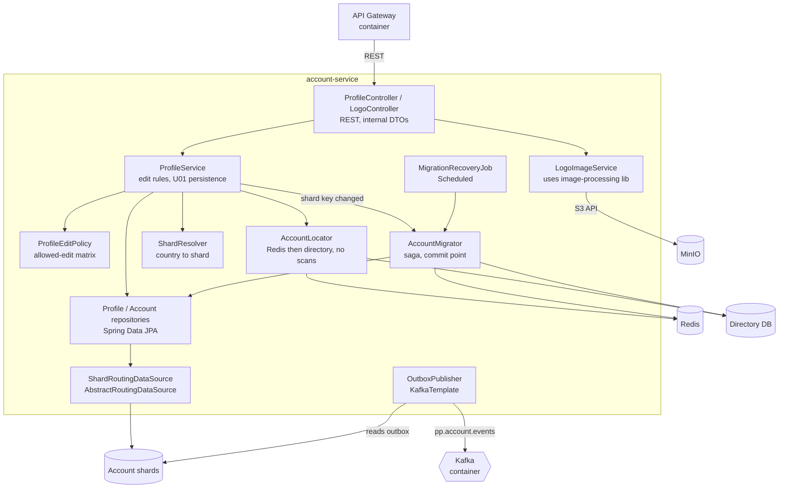
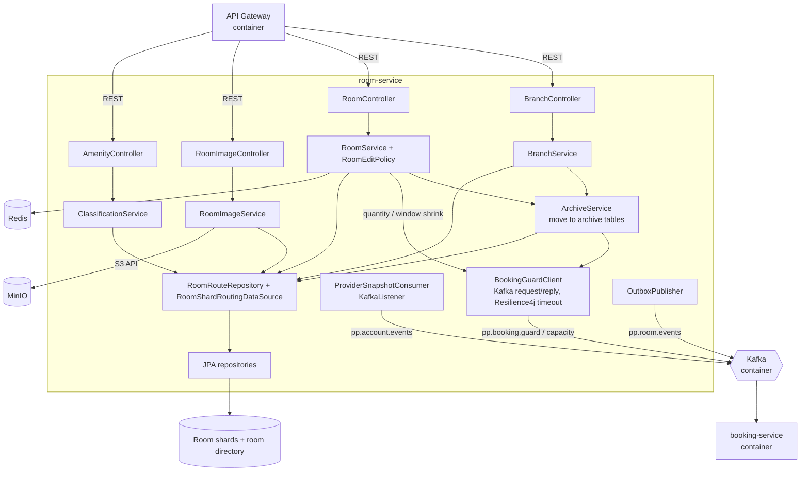

# Provider Profile and Room Resources: Backlog Design

| Item | Value |
|---|---|
| Scope | SRS 2.3 Provider profile management (PP-PROFILE-S01, M01, U01, U02) and SRS 2.4 Room resources, images and classification (PP-ROOM-S01–S06, M01, M02) |
| Sources | `ProviderPortalSRS_v1.0.pdf`, `CommonRequirements_v1.0.pdf`, `api-contract.md` v0.2 |
| Target | Ultimo backend (Spring Boot microservices, Kafka between services), PostgreSQL, Redis, S3-compatible object storage |
| Status | Draft for the Product Backlog. Nothing here is implemented. |
| Date | 2026-11-25 |

**How to read this.** Anything the SRS or contract states is written plainly with its requirement ID. Anything I chose because the SRS leaves it to the team is tagged **[GUESS]** and listed again in §9 so the team can confirm or overrule it. Contract changes are in a separate file, [`api-contract-changes.md`](api-contract-changes.md). `api-contract.md` itself is unchanged. Rendered PNGs of every diagram are in [`diagrams/`](diagrams/).

---

## 1. Summary of the design

1. **Two owning services.** `account-service` owns the provider account and its public profile (SRS 2.3). `room-service` owns branches, rooms, images, amenities and the room archive (SRS 2.4). Each has its own databases and connection strings (BE-U03).
2. **Account shard key = country of residence [GUESS].** PP-PROFILE-U02 only makes sense if a profile edit can change the shard key, and country of residence is the only editable registration field that is a natural placement key. Hashing the account ID would make U02 impossible to demonstrate.
3. **A small global routing directory** (`account_directory`) is the source of truth for "which shard holds this account", keyed by email, phone and SSO subject. Redis caches it (PP-LOGIN-U04). This lets login reach the right shard on a cache miss without scanning shards (PP-LOGIN-U03) and lets registration reject duplicate emails across shards (PP-REG-S02).
4. **Shard migration is a recorded, resumable saga** inside `account-service` with one commit point (the directory flip). This closes the review gaps on failure handling and Redis/phone routing during migration.
5. **Room data is sharded by branch country [GUESS].** Branches must be in the squad's two countries (PP-ROOM-S01), so this gives two shards that line up with search routing (PP-SEARCH-U01). This is optional for the SRS (BE-M07 only requires sharding the Primary Resource, which is reservations), so the team can drop it and use one room database.
6. **Images** go to object storage (MinIO) after server-side resize and compression. Services store only metadata and the object key.
7. **Other services get data through Kafka events**, not by reading these databases: `search-service`, `booking-service` and `event-service` keep their own read copies.

---

## 2. Requirements coverage

| Req | What it needs | Where it lands |
|---|---|---|
| PP-PROFILE-S01 | View/edit permitted account and contact info incl. country of residence; keep validation and SSO no-password rule | `account-service` profile module, `GET/PATCH /providers/me/profile`, allowed-edit matrix §5.3 |
| PP-PROFILE-M01 | Upload logo, auto resize and compress | `PUT /providers/me/logo`, `image-processing` library, MinIO |
| PP-PROFILE-U01 | Persist accepted edits immediately in the right shard; return saved values | Shard routing via `account_directory`; write-through and cache eviction |
| PP-PROFILE-U02 | Migrate the whole account when the shard key changes; login and retrieval still work | Migration saga §6, account record boundary §3.4 |
| PP-ROOM-S01 | Multiple branches; city and country inside the squad subregion | `branch` table, `service_city` reference data |
| PP-ROOM-S02 | Room listings per branch with quantity | `room` table |
| PP-ROOM-S03 | List/view rooms, update permitted room and availability info | Room endpoints, room edit matrix §5.4 |
| PP-ROOM-S04 | Delete subject to booking restrictions by moving to an archive table; keep identity and references; archive excluded from active queries | `room_archive`, `branch_archive`, booking guard request to `booking-service` |
| PP-ROOM-S05 | Multiple images per room, returned with room details | `room_image` |
| PP-ROOM-S06 | Four amenities; keep the provider's category | `amenity` reference table, `provider_profile.category` |
| PP-ROOM-M01 | Add/remove fixed classifications on rooms | `room_amenity` join, `PUT/POST/DELETE` amenity endpoints |
| PP-ROOM-M02 | Booking workflow lists, newest pending first, archive from workflow | Owned by `booking-service`; this design specifies the contract room UI needs (§7.3) |
| 2.4.3 Ultimo | None in the SRS | No Ultimo-only work. Ultimo architecture rules (BE-U01–U08) still apply to both services. |

---

## 3. Data model

Conventions: IDs are UUIDv7 stored as `uuid` [GUESS], generated by the service, so they stay globally unique across shards and never change during migration. Every mutable table has `version bigint` for optimistic locking (JPA `@Version`) and `created_at`/`updated_at` as `timestamptz`. Money is `amount_minor bigint` + `currency char(3)`, matching the contract's `Money`.

### 3.1 Account databases (owned by `account-service`)

There are two kinds of database:

* **Directory DB** (`pp_account_directory`, one instance, small, not sharded): routing and migration bookkeeping.
* **Account shard DBs** (`pp_account_s1`, `pp_account_s2`, `pp_account_s3`, same schema): the account records.

Shard map [GUESS]: squad country A → `s1`, squad country B → `s2`, every other country of residence → `s3`. Residence can be any country (PP-REG-S04), so a catch-all shard is needed. Two shards (A, and everyone else) also works if the team wants fewer databases.



Each account shard holds the same schema:



Notes:

* `PROVIDER_ACCOUNT` and `PROVIDER_PROFILE` are split because the account is private identity data (BE-M05: do not leak it) and the profile is what CP and search may see. They stay 1:1 in the same shard.
* `SSO_IDENTITY` and `ACTIVATION_TOKEN` belong to features 2.1/2.2. They are shown because the migration must move them too (§3.4). Their owners may model them differently.
* Login lockout counters and token revocation live in Redis (PP-LOGIN-M02/M04), so they are not in the shard and need no migration. Refresh tokens: if 2.2 stores them in a shard table, add that table to §3.4.
* `MOVED` stub rows: after a migration, the source shard keeps a one-row stub (`status = MOVED`, `moved_to_shard`) for a grace period [GUESS: 7 days] so a stale Redis entry gets a redirect instead of "account not found". This is a redirect, not a probe, so it stays within PP-LOGIN-U03.

### 3.2 Room databases (owned by `room-service`)

Sharded by `branch.country_code` [GUESS]: `pp_room_<countryA>` and `pp_room_<countryB>`. Reference tables (`amenity`, `service_city`) are copied into every shard by Flyway. Room and branch IDs carry no shard information in the API; `room-service` keeps a small `room_route` table in its own directory DB [GUESS] so `GET /rooms/{id}` and Kafka look-ups by `roomId` reach one shard.



Room-service directory DB (`pp_room_directory`, not sharded): `room_route(room_id PK, branch_id, country_code, archived boolean)` and `branch_route(branch_id PK, provider_id, country_code, archived boolean)`. It also gives a provider-wide room list across both countries without scanning: `branch_route` by `provider_id` tells which shards hold that provider's branches.

Notes:

* **Archive (PP-ROOM-S04).** Archive is a move, done in one local transaction in the room's shard: insert into `room_archive`, delete `room_image`/`room_amenity`/`room` rows, set `room_route.archived = true`, write the outbox event. The ID is kept, so bookings that store `roomId` still resolve through `GET /rooms/{id}?includeArchived=true` (owner and booking-service only). Image objects stay in MinIO. Ordinary list and search queries never touch `*_archive` tables. Archiving a branch requires all its rooms to be archivable and archives them in the same transaction.
* **Amenities (PP-ROOM-S06, M01).** One fixed reference table, seeded with the union of the SRS lists, which matches the contract's 7-value `Amenity` enum: `FREE_WIFI`, `KITCHEN`, `WASHING_MACHINE`, `PETS_ALLOWED` (SRS 2.4.1) and `PRIVATE_BATHROOM`, `AIR_CONDITIONING`, `DISABLED_FACILITIES` (SRS 2.5.1). Providers can assign only, never create codes.
* **Category.** The SRS puts the category on the provider (2.3 intro, PP-ROOM-S06 "retain the provider's category"). It is stored once in `provider_profile.category` and copied into `provider_snapshot`. Room type is a separate fixed classification on the room.
* **Availability.** `room` holds the static fact (how many units exist and in what date window they are sold). Booked units per night belong to `booking-service`, which has to reserve inventory atomically with the booking (contract §4, "Reserve"). Available quantity for dates = `quantity` minus booked units, computed by `booking-service`/`search-service` from room events. Lowering `quantity` below units already booked on any future night is rejected (§5.4).

### 3.3 Relationship to other services' data



There are no foreign keys across services (BE-U03). References are by ID only, and each consumer keeps a snapshot of the fields it displays (for example, a booking stores `roomName` at booking time).

### 3.4 Account record boundary (what "complete account record" means for PP-PROFILE-U02)

Moved together, in the target shard's single transaction:

| Table | Owner feature | Moves? |
|---|---|---|
| `provider_account` | 2.1 / 2.3 | Yes |
| `provider_profile` | 2.3 | Yes |
| `profile_image` metadata | 2.3 | Yes (rows only; the MinIO object key does not depend on the shard) |
| `sso_identity` | 2.1 Ultimo | Yes |
| `activation_token` (unused only) | 2.1 | Yes |
| Any per-account table 2.1/2.2 add later | 2.1 / 2.2 | Yes. Rule: every table in an account shard must be keyed by `account_id` and registered in the migrator's table list, or the build fails a test [GUESS]. |
| `account_directory` row | 2.3 | Updated in place (commit point) |
| Redis `route:email:*`, `route:phone:*` | 2.2 / 2.3 | Rewritten after the commit point |
| Redis lockout counters, revoked tokens | 2.2 | No (not shard data) |
| Branches, rooms, images | 2.4 (`room-service`) | No. They are in a different service and keyed by `provider_id`, which does not change. |
| Bookings, PMS subscription | 2.6 / 2.9 | No, same reason |

---

## 4. Service and module structure

### 4.1 Services (Spring Boot 3.x, Java 21) [GUESS on versions]

| Service | Bounded context | Owns | In scope here |
|---|---|---|---|
| `api-gateway` | Entry point, JWE validation, rate limit (BE-U04, BE-U05) | none | Routes only |
| `discovery-server` | Eureka with basic-auth (BE-U06) | none | No |
| `account-service` | Provider account: registration, profile, shard placement | Directory DB, account shards, Redis routing keys | **Yes (2.3)**; registration (2.1) is another backlog item in the same service [GUESS] |
| `auth-service` | Login, tokens, revocation (2.2) | Redis revocation | Dependency only |
| `room-service` | Branches, rooms, images, classifications, archive | Room directory DB, room shards, MinIO `rooms/` prefix | **Yes (2.4)** |
| `search-service` | FTS, partner search PP-01/02/03 (2.5) | Search read model | Consumer of our events |
| `booking-service` (+ redundant instance) | Reservations, inventory allocation, approval (2.6) | Booking shards | Consumer; answers our guard check; serves PP-ROOM-M02 lists |
| `event-service` | Regional event suggestions (2.10) | Schedules | Consumer of profile events |
| MinIO | Object storage (external container) | Image objects | Used by both |

Whether registration lives in `account-service` or `auth-service` is for whoever owns 2.1/2.2. This design only needs one rule: **one service owns the account shards and the directory**, and that service is the only writer of the Redis routing keys.

### 4.2 Internal module layout (same pattern in both services, BE-M01–M06 inside a microservice)

```
account-service/
  src/main/java/.../account/
    profile/                         # SRS 2.3 module
      api/                           # presentation: ProfileController, LogoController
      api/dto/                       # internal DTOs: ProfileView, ProfilePatchRequest, LogoView
      application/                   # ProfileService (interface), ProfileServiceImpl
      application/ProfileEditPolicy  # allowed-edit matrix (§5.3)
      domain/                        # ProviderAccount, ProviderProfile, ProfileImage (JPA entities)
      infrastructure/                # ProfileRepository, ProfileImageRepository (Spring Data JPA)
    placement/                       # shard placement and migration
      application/ShardResolver      # country -> shard via shard_country_map
      application/AccountLocator     # accountId/email/phone -> shard (Redis then directory)
      application/AccountMigrator    # saga steps §6
      application/MigrationRecoveryJob  # @Scheduled, resumes unfinished migrations
      infrastructure/ShardRoutingDataSource  # AbstractRoutingDataSource keyed by ShardContext
      infrastructure/DirectoryRepository, MigrationRepository
      infrastructure/RoutingCache    # Spring Data Redis, route:email/phone keys
    shared/
      external/ProfileQueryApi       # external service API (BE-M03/M04) used by other modules
      external/dto/ProviderPublicDto # external DTO (BE-M06)
      messaging/OutboxPublisher      # polls outbox_event per shard -> KafkaTemplate
      messaging/KafkaTopics
      media/                         # thin wrapper over image-processing lib + S3 client
      security/                      # reads gateway-forwarded identity, role checks

room-service/
  src/main/java/.../room/
    branch/      api, application, domain, infrastructure
    room/        api, application (RoomService, RoomEditPolicy), domain, infrastructure
    image/       api (RoomImageController), application (RoomImageService), infrastructure (S3)
    classification/  api (AmenityController), application, infrastructure (AmenityRepository)
    archive/     application (ArchiveService), infrastructure (RoomArchiveRepository)
    integration/
      BookingGuardClient            # Kafka request/reply to booking-service
      ProviderSnapshotConsumer      # @KafkaListener pp.account.events
      OutboxPublisher
    shared/routing/RoomShardRoutingDataSource, RoomRouteRepository

libs/
  image-processing/                  # shared jar: validate, strip EXIF, resize, WebP/JPEG compress
  pp-kafka-envelope/                 # envelope (messageId, correlationId, type, attempt) and retry helper
```

Main libraries [GUESS]: Spring Web, Spring Data JPA + Hibernate, PostgreSQL driver, Flyway (one migration set applied to every shard), Spring Kafka, Spring Data Redis (Lettuce), Spring Cloud Netflix Eureka client, Spring Cloud Gateway, Resilience4j, MapStruct for DTO mapping, Jakarta Bean Validation, AWS SDK v2 S3 client (works with MinIO), Thumbnailator + TwelveMonkeys ImageIO (or `webp-imageio`) for resize/WebP.

**Shard routing in Spring.** Each service registers one `DataSource` per shard and an `AbstractRoutingDataSource` whose lookup key comes from a request-scoped `ShardContext`. Service methods call `AccountLocator`/`RoomRouteRepository` first, set the context, then run the `@Transactional` work. The migration copy uses two explicit `TransactionTemplate`s (source and target), not a distributed transaction.

### 4.3 REST APIs through the gateway (frontend → services)

All endpoints need a valid access JWE (PP-LOGIN-U02). The gateway decrypts it and forwards `X-Account-Id` and `X-Role` on the internal hop [GUESS]. Services act only on the caller's own `accountId`/`providerId`; an ID that belongs to someone else returns `404` so existence is not revealed. Writes take `If-Match: <version>` and return `409 VERSION_CONFLICT` on a stale version. Errors use the contract's `Error` shape `{code, message, retryable}` plus `fieldErrors[]` for validation.

**Profile (`account-service`)**

| Method and path | Purpose | Req | Request | Response / errors |
|---|---|---|---|---|
| `GET /api/v1/providers/me/profile` | View own account and profile | S01, U01 | — | `ProfileView` (account contact fields, profile fields, `logo`, `authType`, `editableFields[]`, `version`) |
| `PATCH /api/v1/providers/me/profile` | Edit permitted fields | S01, U01, U02 | `ProfilePatchRequest` (any subset of editable fields), header `Idempotency-Key` | `200 ProfileView` when saved in place or migrated; `202 {migrationId}` only if the team chooses async migration [GUESS: sync is the default]; `400 VALIDATION_ERROR`, `403 FIELD_NOT_EDITABLE`, `409 VERSION_CONFLICT`, `409 PHONE_ALREADY_USED`, `423 ACCOUNT_MIGRATING`, `503 MIGRATION_TEMPORARILY_UNAVAILABLE` (retryable, nothing changed) |
| `PUT /api/v1/providers/me/logo` | Upload or replace logo (multipart `file`) | M01 | JPEG/PNG/WebP, ≤ 5 MB [GUESS] | `200 LogoView {url, width, height, sizeBytes}`; `415 UNSUPPORTED_IMAGE_TYPE`, `413 IMAGE_TOO_LARGE`, `422 IMAGE_UNREADABLE` |
| `DELETE /api/v1/providers/me/logo` | Remove logo | M01 | — | `204` |
| `GET /api/v1/reference/countries` | Selectable country list | S01 (PP-REG-S04) | — | `[{code, name, dialCode}]` |
| `GET /api/v1/reference/provider-categories` | Category list | 2.3 | — | `ProviderCategory[]` |

`PUT /api/v1/providers/me/password` stays with 2.2 and must return `403 SSO_ACCOUNT_NO_PASSWORD` for SSO accounts.

**Branches and rooms (`room-service`)**

| Method and path | Purpose | Req |
|---|---|---|
| `GET /api/v1/reference/cities` | Cities allowed in the squad subregion | S01 |
| `GET /api/v1/reference/amenities`, `GET /api/v1/reference/room-types` | Fixed classifications | S06, M01 |
| `POST /api/v1/branches` | Create branch (`name, addressLine, cityCode, postcode, phone`); country is derived from `cityCode`; `422 CITY_OUTSIDE_SUBREGION` | S01 |
| `GET /api/v1/branches` | List own active branches (paged) | S01 |
| `GET/PATCH /api/v1/branches/{branchId}` | View/edit branch; city change across countries rejected `422 BRANCH_COUNTRY_IMMUTABLE` [GUESS] | S01 |
| `DELETE /api/v1/branches/{branchId}` | Archive branch and its rooms; `409 ACTIVE_BOOKINGS_EXIST` with `blockingRooms[]` | S04 |
| `POST /api/v1/branches/{branchId}/rooms` | Create room (`name, description, roomType, maxGuests, quantity, pricePerNight, availableFrom?, availableUntil?, amenities[]`) | S02, S06 |
| `GET /api/v1/branches/{branchId}/rooms`, `GET /api/v1/rooms?branchId=&roomType=&page=` | List own rooms with cover image and amenities | S03 |
| `GET /api/v1/rooms/{roomId}` | Room details with all images and amenities; `?includeArchived=true` for the owner | S03, S05 |
| `PATCH /api/v1/rooms/{roomId}` | Edit permitted fields (§5.4); `409 QUANTITY_BELOW_BOOKED` | S03 |
| `DELETE /api/v1/rooms/{roomId}` | Archive; `409 ACTIVE_BOOKINGS_EXIST`; `503 BOOKING_CHECK_UNAVAILABLE` (retryable, nothing archived) | S04 |
| `GET /api/v1/archive/rooms`, `GET /api/v1/archive/branches` | Owner view of archived records (read-only) [GUESS] | S04 |
| `POST /api/v1/rooms/{roomId}/images` | Upload one or more images (multipart); max 10 per room [GUESS] | S05 |
| `PATCH /api/v1/rooms/{roomId}/images/order` | Reorder (`imageIds[]`), first = cover | S05 |
| `DELETE /api/v1/rooms/{roomId}/images/{imageId}` | Remove image | S05 |
| `PUT /api/v1/rooms/{roomId}/amenities` | Replace the set (`amenityCodes[]`) | M01 |
| `POST /api/v1/rooms/{roomId}/amenities/{code}`, `DELETE …/{code}` | Add/remove one | M01 |

**Booking workflow lists for PP-ROOM-M02 (served by `booking-service`, specified here so the room UI can use it)**

| Method and path | Purpose |
|---|---|
| `GET /api/v1/bookings?view=PENDING|APPROVED|CANCELLED|COMPLETED|ARCHIVED&roomId=&branchId=&cursor=` | Workflow lists. `PENDING` sorted by `createdAt desc` so new pending records come first. |
| `POST /api/v1/bookings/{bookingId}/workflow-archive` / `DELETE …/workflow-archive` | Hide/unhide from active workflow. Sets `workflow_archived_at` only. Does not change `BookingStatus`, inventory, payment or CP-01 events. |

### 4.4 Kafka topics

Partner topics stay as in `api-contract.md`. The topics below are internal to PP (BE-U02). Envelope = the contract's envelope (§1) so one library serves both [GUESS]. All events are full snapshots with a `version`, published through a transactional outbox so a DB commit and its event cannot diverge.

| Topic | Key | Producer → consumers | Message types | Payload (main fields) |
|---|---|---|---|---|
| `pp.account.events` | `accountId` | `account-service` → `room-service`, `search-service`, `event-service`, `booking-service` | `provider.profile.updated` | `providerId, displayName, category, logoUrl, city?, countryOfResidence, profileVersion, updatedAt` (public fields only, BE-M05) |
| | | | `provider.account.migrated` | `accountId, fromShard, toShard, routingVersion, migratedAt` (for `auth-service` cache eviction and audit) |
| `pp.room.events` | `roomId` (branch events keyed by `branchId`) | `room-service` → `search-service`, `booking-service`, `event-service` | `branch.upserted`, `branch.archived` | Branch snapshot incl. `providerId, cityCode, countryCode, version` |
| | | | `room.upserted` | Room snapshot: `roomId, branchId, providerId, name, description, roomType, maxGuests, quantity, pricePerNight, availableFrom, availableUntil, bookable, images[{url, thumbUrl, sortOrder}], amenities[], version` |
| | | | `room.archived` | `roomId, branchId, providerId, archivedAt, version` |
| `pp.booking.guard.request` | `roomId` or `branchId` | `room-service` → `booking-service` | `room.archive.check.request` | `scope: ROOM|BRANCH, ids[], requestedBy, asOf` |
| `pp.booking.guard.response` | same | `booking-service` → `room-service` | `room.archive.check.response` | `allowed: boolean, blocking[{roomId, activeBookingCount, maxBookedUnitsOnAnyFutureNight}]` |
| `pp.booking.capacity.request` / `.response` | `roomId` | `room-service` ↔ `booking-service` | `room.capacity.check.*` | Request `roomId, newQuantity, newAvailableFrom?, newAvailableUntil?`; response `allowed, maxBookedUnits, conflictingDates[]` |
| `pp.*.dlq` | as source | any consumer | dead letters after retries | original record + error |

Partitions and retention [GUESS]: 6 partitions per topic, `cleanup.policy=compact` on `pp.account.events` and `pp.room.events` so a new consumer can rebuild its read model from the latest snapshot per key; request/response topics use 7-day delete retention. Request/reply follows INT-U02/U03: correlation ID, 5 s timeout, up to 3 resends.

Room archive sequence: `room-service` sends the guard request, waits for the reply, then archives locally only if `allowed`. To close the race with a booking created after the reply, `booking-service` must reject new bookings for a room once it has seen `room.archived`, and `room-service` sets `bookable = false` (published as `room.upserted`) **before** asking the guard [GUESS]. If the guard says no, `bookable` is restored.

---

## 5. Behaviour rules

### 5.1 Validation reused from 2.1

Phone uses PP-REG-M03 (valid dialing code, under 13 digits after it), stored as `phone_country_code` + `phone_number` and indexed as E.164 in the directory. Email uses PP-REG-M02. Country uses the selectable list (PP-REG-S04). The same `ValidationRules` component is shared by registration and profile so a direct backend call cannot bypass it.

### 5.2 Logo and room image processing (PP-PROFILE-M01, PP-ROOM-S05) [GUESS on all numbers]

| | Logo | Room image |
|---|---|---|
| Accepted input | JPEG, PNG, WebP; ≤ 5 MB; ≤ 6000×6000 | Same; ≤ 8 MB |
| Stored output | 256×256 WebP, centre-cropped, quality 80 | 1600 px longest side WebP q80 + 400 px thumbnail |
| Limit | 1 current (old versions marked `SUPERSEDED`, purged after 7 days) | 10 per room |
| Processing | Check magic bytes (not just extension), strip EXIF, resize, compress, write to MinIO, then insert metadata row | same |

Writes to MinIO happen before the DB transaction. A failed DB commit leaves an orphan object, which a nightly job removes by comparing keys with metadata.

### 5.3 Allowed-edit matrix for profile (closes the "allowed edit" gap) [GUESS, needs team sign-off]

| Field | Local account | SSO account | Effect |
|---|---|---|---|
| Company name, address | Editable | Editable | In place |
| Display name, category, description, public contact, website | Editable | Editable | In place; emits `provider.profile.updated` |
| Phone (`phone_country_code`, `phone_number`) | Editable, PP-REG-M03, unique in directory | Editable | In place; directory `phone_e164` and Redis phone key updated in the same flow |
| **Country of residence** | Editable | Editable | **May change shard → migration (§6)** |
| Email | Read-only in 2.3 | Read-only (comes from the SSO provider) | Changing a login identifier needs a re-verification flow; propose a separate backlog item |
| Password | Not here (2.2 flow) | Never (PP-REG-U02) | — |
| Auth type, role, status, account ID | Never | Never | — |

The SRS uses "country of residence" in PP-PROFILE-S01 and "country of operation" in its evidence line. This design treats them as the same field because the profile has no other country. Branch countries are on branches.

### 5.4 Room edit rules (PP-ROOM-S03) [GUESS]

| Field | Rule |
|---|---|
| Name, description, images, amenities, price | Always editable. Price changes do not affect accepted bookings or open quotes (contract D6). |
| `quantity` | Editable; lowering it below booked units on any future night is rejected after a `room.capacity.check` with `booking-service`. |
| `availableFrom` / `availableUntil` | Editable; shrinking the window past a night with bookings is rejected the same way. |
| `maxGuests` | Editable; does not affect existing bookings. |
| `roomType` | Editable only if the room has no active bookings. |
| `branchId` | Not editable (create a new room instead). |
| `bookable` | Editable; `false` hides the room from search without deleting it. |

"Active booking" [GUESS] = status `PENDING` or `APPROVED` with `checkOut` after today in the branch's timezone.

---

## 6. Shard migration on profile edit (PP-PROFILE-U01, U02)

Triggered when a `PATCH` changes `countryOfResidence` and `ShardResolver` maps the new country to a different shard. Otherwise the edit is a normal in-place update in the current shard (U01).



Failure handling (the review gap):

| Fails at | Outcome | Recovery |
|---|---|---|
| Before the commit point (steps 5–9) | Directory still points to the source; source data unchanged. | Roll back: delete partial target rows, source status back to `ACTIVE`, directory back to `ACTIVE`, migration `ROLLED_BACK`. User gets `503 MIGRATION_TEMPORARILY_UNAVAILABLE` and can retry. Login and profile reads kept working from the source the whole time. |
| Commit point itself (step 10) | It is one single-row transaction, so it either happened or not. | Recovery job reads `account_migration` and the directory and continues from the true state. |
| After the commit point (steps 11–16) | The account is already live in the target. | `MigrationRecoveryJob` retries the remaining steps until `CLEANED`. Stale Redis entries are safe: a lookup that lands on the source finds a `MOVED` stub and follows `moved_to_shard` once, then repairs Redis. |
| Service crash mid-way | `account_migration` has the last completed step. | On startup and every minute, the job resumes or rolls back each unfinished migration. Steps are idempotent (upserts keyed by `account_id`). |

Routing during migration:

* **Login by email or phone** (PP-LOGIN-U03/U04): Redis → shard; on a miss, the directory → shard; never a scan. While `MIGRATING`, the directory still names the source, which is still complete and readable, so login works. After the switch, the directory names the target.
* **Phone routing.** PP-LOGIN-U04 only names an email map. This design adds `route:phone:{e164}` in Redis and `phone_e164` in the directory so phone login has the same no-scan path. A phone edit updates both.
* **Tokens.** Access and refresh JWEs carry `accountId` and role, never a shard ID [GUESS], so existing sessions survive a migration without re-login.
* **Concurrent edits.** Only one migration per account (directory CAS). Other writes during the short `MIGRATING` window get `423 ACCOUNT_MIGRATING` (retryable).
* **Duplicate request.** `Idempotency-Key` is stored as `requested_edit_id`; a replay returns the original result.

Redis keys and cache rules (BE-M08):

| Key | Value | TTL | Written by | Invalidated |
|---|---|---|---|---|
| `route:email:{email}` | `{shardId, accountId, rv}` | 24 h | `account-service` | Overwritten on migration; refreshed on miss |
| `route:phone:{e164}` | same | 24 h | `account-service` | Phone edit (delete old, set new), migration |
| `profile:{accountId}` | `ProfileView` JSON | 10 min | `account-service` on read | Evicted after every committed profile write |
| `room:{roomId}` | room detail DTO | 10 min | `room-service` on read | Evicted on any room/image/amenity write or archive |
| `ref:cities`, `ref:amenities` | reference lists | 1 h | both | Flyway seed change / restart |

---

## 7. What these features take from and give to other modules

### 7.1 Provider profile (`account-service`, SRS 2.3)

| Takes from | What | How |
|---|---|---|
| Registration (2.1) | Account rows, shard key choice (PP-REG-U03), validation rules (PP-REG-M02/M03/S04), SSO link | Same service and shards [GUESS] |
| Login/auth (2.2) | Authenticated identity (`accountId`, role) from the JWE; the Redis routing key format (PP-LOGIN-U04) | Gateway header; shared key format |
| API gateway | Routing, rate limit, token check | REST |
| MinIO | Object storage for logos | S3 API |

| Gives to | What | How |
|---|---|---|
| Login/auth (2.2) | Up-to-date email/phone → shard routing, including after phone edits and migrations | Directory DB + Redis keys; `provider.account.migrated` |
| Room service (2.4) | Provider display name, category, logo URL for room screens and owner checks | `pp.account.events` |
| Search (2.5) | Provider name (searched by PP-SEARCH-S01), category, logo URL | `pp.account.events` → CP via PP-01/PP-02 |
| Booking (2.6) | Provider name for booking snapshots | `pp.account.events` |
| Event suggestions (2.10) | Name, category, logo URL (PP-EVENT-S02, PP-07b) | `pp.account.events` |
| PMS subscription (2.9) | Profile page shows subscription status and period (PP-PMS-S01) | Profile page reads from the PMS/subscription service; not stored in profile [GUESS] |
| Frontend | Profile view/edit, logo upload | REST |

### 7.2 Room resources (`room-service`, SRS 2.4)

| Takes from | What | How |
|---|---|---|
| Profile (2.3) | Provider snapshot | `pp.account.events` |
| Login/auth (2.2) | Caller identity for ownership checks | Gateway header |
| Booking (2.6) | "Can this room/branch be archived?" and "Can quantity/window shrink?" | `pp.booking.guard.*`, `pp.booking.capacity.*` request/reply |
| Squad agreement | Two countries, city list and codes (contract D3) | Flyway reference data |
| MinIO | Image storage | S3 API |

| Gives to | What | How |
|---|---|---|
| Search (2.5) | Authoritative rooms, branches, images, amenities, prices, quantities, archive removals; city/country for shard-aware search (PP-SEARCH-U01) | `pp.room.events` |
| Booking (2.6) | Room price, quantity, window, `bookable`, name for snapshots, archive notice | `pp.room.events` |
| Event suggestions (2.10) | Price per night per provider and city | `pp.room.events` |
| Discounts (2.8) | Room IDs for policy assignment | `pp.room.events` |
| PMS (2.9) | Rooms flagged for cross-platform sharing (future field) | Not in this design; add when D11 is agreed |
| CP (partner) | Indirectly, through `search-service` (PP-01/02/03) | Kafka partner topics |
| Frontend | Branch/room/image/amenity management | REST |

### 7.3 Booking workflow lists (PP-ROOM-M02)

The requirement sits in 2.4 but the data is bookings. `booking-service` needs: a `workflow_archived_at timestamptz null` column on its booking table, the two REST endpoints in §4.3, and a `created_at desc` index for the pending list. This is a change request to the 2.6 owner, not new tables here.

---

## 8. C4 diagrams

ARCH-D01 asks for exactly one backend container diagram for the whole subsystem. The container view below is the **slice for these two features** so the team can merge it into the single diagram. The two component diagrams are candidates for ARCH-D02, which needs components that talk to each other, to the partner and to an external system. `account-service` meets that only through `search-service`, so the strongest ARCH-D02 picks are probably `booking-service` and `search-service`; these two are still useful for the report and feature traces (M1-P02).

### 8.1 Container view (backend slice)



### 8.2 Component view: `account-service` (profile + placement)



### 8.3 Component view: `room-service`



---

## 9. Open decisions and guesses to confirm

| # | Decision | Proposal in this doc | Who decides |
|---|---|---|---|
| G1 | Account shard key | Country of residence, 3 shards (country A, country B, rest) | PP team with 2.1/2.2 owners (PP-REG-U03) |
| G2 | Global routing directory | Yes, small PostgreSQL DB + Redis cache | PP team |
| G3 | Which service owns registration and account shards | `account-service` | 2.1/2.2 owners |
| G4 | Editable profile fields | §5.3 matrix; email read-only | PP team (SRS says "permitted", no list) |
| G5 | "Country of residence" vs "country of operation" | Same field | Ask lecturer if unsure |
| G6 | Migration sync vs async | Synchronous inside the PATCH (simple to demo); async 202 kept as fallback | PP team |
| G7 | Room DB sharding | By branch country, 2 shards + small directory | PP team; optional under BE-M07 |
| G8 | Image limits and sizes | §5.2 numbers | PP team, then contract |
| G9 | Room edit and delete restrictions | §5.4; "active booking" definition | PP team with 2.6 owner |
| G10 | Availability window fields on rooms | `availableFrom/Until` + `bookable` | PP team |
| G11 | Workflow archive in booking-service | `workflow_archived_at` column + 2 endpoints | 2.6 owner |
| G12 | JWE never carries shard ID | Yes | 2.2 owner |
| G13 | Provider display name vs company name | Separate `display_name`, defaults to company name; display name is what search matches | PP team, then contract |
| G14 | Room price currency | Per branch country from `service_city.currency` | PP team with CP (contract) |

---

## 10. Backlog items (ready to copy into the Product Backlog)

Each item still needs an assignee, deadline, estimate and Definition of Done when it moves to Sprint Backlog (TW-S03, TW-U01).

| ID | Title | Req | Depends on |
|---|---|---|---|
| PRF-01 | Profile data model and Flyway scripts for account shards and directory | S01, U01 | G1–G3 |
| PRF-02 | Shard routing data source and `AccountLocator` (Redis → directory, no scans) | U01 | PRF-01, PP-LOGIN-U04 key format |
| PRF-03 | `GET/PATCH /providers/me/profile` with allowed-edit policy and validation reuse | S01, U01 | PRF-02, G4 |
| PRF-04 | Logo upload: image-processing library, MinIO bucket, `PUT/DELETE /providers/me/logo` | M01 | — |
| PRF-05 | Account migration saga, rollback and recovery job | U02 | PRF-02, PRF-03 |
| PRF-06 | Redis phone and email route updates on phone edit and migration | U02, PP-LOGIN-U03 | PRF-05 |
| PRF-07 | Outbox + `pp.account.events` publisher | 2.5/2.10 support | PRF-01 |
| PRF-08 | Migration demo script and test: edit country, verify shard, login by email and phone | U02 evidence | PRF-05, PRF-06, 2.2 login |
| ROOM-01 | Room data model, reference data (cities, amenities, room types), Flyway for room shards | S01, S02, S06 | G7, contract D3 |
| ROOM-02 | Branch CRUD with subregion check | S01 | ROOM-01 |
| ROOM-03 | Room CRUD with edit policy | S02, S03 | ROOM-01 |
| ROOM-04 | Room images upload/reorder/delete | S05 | PRF-04 library |
| ROOM-05 | Amenity assignment endpoints | S06, M01 | ROOM-03 |
| ROOM-06 | Archive rooms and branches with booking guard request/reply | S04 | ROOM-03, booking-service guard handler |
| ROOM-07 | Capacity check before lowering quantity or window | S03 | booking-service capacity handler |
| ROOM-08 | Outbox + `pp.room.events`; provider snapshot consumer | 2.5/2.6 support | ROOM-01, PRF-07 |
| ROOM-09 | Ask 2.6 owner: workflow archive column and list endpoints | M02 | G11 |
| DOC-01 | Raise the contract changes in `api-contract-changes.md` with CP | TW-S06 | — |
| DOC-02 | Add ERD, component diagrams and feature trace to the Milestone 1 report | M1-D01, M1-P02 | this doc |
